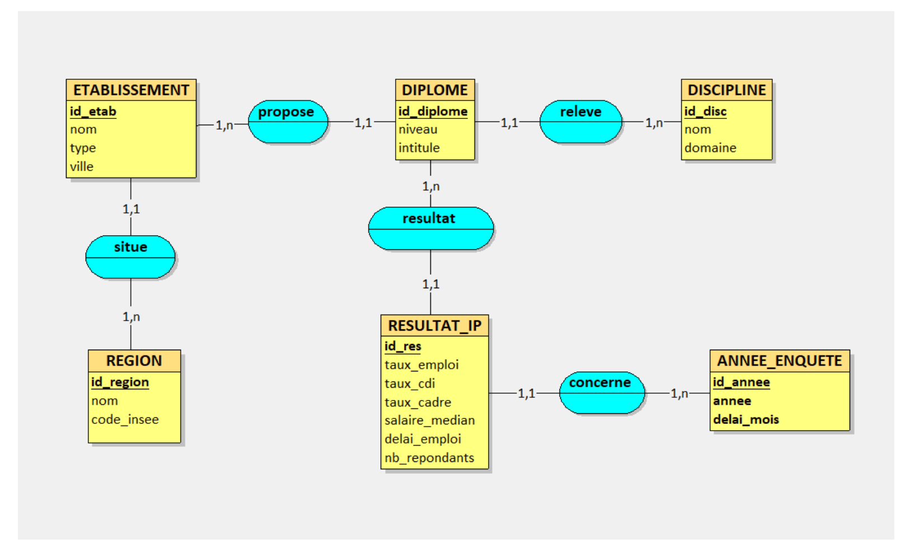

# Observatoire de l'insertion professionnelle des diplômés de Master

Application web (MySQL / PHP) permettant d'observer et de comparer l'insertion professionnelle des diplômés de Master en France, par formation, établissement, discipline et région. Projet réalisé en équipe dans le cadre du cours de représentation des données (Master 1 Informatique & Big Data, Université Paris 8).

Les données proviennent du jeu de données open data du Ministère de l'Enseignement Supérieur (MESRI) sur l'insertion professionnelle des diplômés de Master, avec des enquêtes à 18 et 30 mois après l'obtention du diplôme.

## Fonctionnalités

- **Tableau de bord national** : taux d'emploi, taux de CDI, taux cadre, salaire médian, top 5 des disciplines et top 5 des formations selon un indice d'attractivité composite.
- **Fiche formation** : évolution des indicateurs par année et par délai d'enquête, comparés à la moyenne de la discipline.
- **Fiche établissement** : classement interne de toutes les formations d'un établissement.
- **Comparaison côte à côte** : de deux formations ou de deux établissements.
- **Requêtes SQL interactives** : 8 requêtes analytiques (agrégations, sous-requêtes corrélées, auto-jointures temporelles, LEFT JOIN / IS NULL).

## Ce qui a été réalisé

### 1. Traitement des données (CSV MESRI, 19 603 lignes, 35 colonnes)
- Remplacement des valeurs masquées (`nd`, `ns`) par des valeurs vides, interprétées comme `NULL` en SQL.
- Unification des colonnes « Établissement » et « Établissement actuel » pour obtenir un nom unique par université.
- Enrichissement géographique (ville, région, code INSEE) via l'API open data du Ministère, à partir du code UAI de chaque établissement.
- Ajout d'un indicateur de faible effectif (moins de 20 répondants).

### 2. Modélisation
- MCD et MLD en 6 tables : `REGION`, `ETABLISSEMENT`, `DISCIPLINE`, `DIPLOME`, `ANNEE_ENQUETE`, `RESULTAT_IP`.
- Contraintes d'intégrité : clés étrangères, `CHECK` (taux d'emploi entre 0 et 100, salaire strictement positif), `UNIQUE` composites, index sur la table de résultats.

### 3. Requêtes SQL

| Requête | Objectif | Technique |
|---|---|---|
| R1 | Disciplines avec le meilleur taux cadre | `AVG` + `GROUP BY` + `ORDER BY` |
| R2 | Établissements au-dessus de la moyenne de leur discipline | Sous-requête scalaire corrélée |
| R3 | Évolution du taux CDI par discipline | `GROUP BY` discipline et année |
| R4 | Disciplines en déclin continu | Triple auto-jointure temporelle |
| R5 | Formations à fort taux cadre et fort salaire | Jointures + condition multi-critères |
| R6 | Régions les mieux insérées | `GROUP BY` région |
| R7 | Diplômes sans enquête récente | `LEFT JOIN` + `IS NULL` |
| R8 | Gain d'insertion entre 18 et 30 mois | Double jointure sur `delai_mois` |

### 4. Interface web
- PHP sans framework, connexion PDO.
- Requêtes préparées (protection contre l'injection SQL), échappement des sorties avec `htmlspecialchars()`, conversion des identifiants en entiers.
- Interface responsive avec variables CSS.

## Modèle conceptuel de données



Un établissement est situé dans une région et propose des diplômes. Chaque diplôme relève d'une discipline et possède des résultats d'insertion (`RESULTAT_IP`), chacun rattaché à une année et un délai d'enquête (18 ou 30 mois).

## Structure du dépôt

```
.
├── css/style.css
├── docs/
│   ├── rapport.pdf            Rapport complet du projet
│   └── mcd.png                Modèle conceptuel de données
├── sql/
│   ├── creation.sql           Création de la base et des tables
│   └── insertion.sql          Jeu de données de démonstration
├── connexion.example.php      Modèle de configuration de la base
├── index.php                  Tableau de bord
├── formation.php              Fiche formation
├── etablissement.php          Fiche établissement
├── comparaison.php            Comparaison côte à côte
├── stats.php                  Requêtes R1 à R8
└── nav.php                    Barre de navigation
```

## Installation

Prérequis : un serveur local PHP + MySQL (MAMP, XAMPP ou WAMP).

1. Cloner le dépôt dans le dossier web du serveur (`htdocs`) :
   ```bash
   git clone https://github.com/JinPyy/observatoire-insertion-pro.git
   cd observatoire-insertion-pro
   ```
2. Créer la base et les tables, puis insérer les données :
   ```bash
   mysql -u root -p < sql/creation.sql
   mysql -u root -p projet_ip < sql/insertion.sql
   ```
   (ou importer les deux fichiers via phpMyAdmin)
3. Créer le fichier de configuration à partir du modèle :
   ```bash
   cp connexion.example.php connexion.php
   ```
   Puis renseigner dans `connexion.php` l'hôte, le port, l'utilisateur et le mot de passe MySQL.
4. Ouvrir `http://localhost/observatoire-insertion-pro/index.php` (adapter le port selon le serveur, par exemple `:8888` avec MAMP).

## À propos des données

Le jeu de données source du MESRI (19 603 lignes) a été nettoyé et enrichi comme décrit ci-dessus. La base fournie dans `sql/insertion.sql` est un **jeu de démonstration** : un échantillon de 8 établissements, 115 diplômes et 1 000 résultats, complété par des valeurs extrapolées de façon réaliste. Les chiffres affichés par l'application ne doivent donc pas être interprétés comme des statistiques officielles.

## Limites et pistes d'amélioration

- Ajouter des graphiques dynamiques (Chart.js).
- Ajouter de la pagination pour les tableaux volumineux.
- Ajouter des filtres avancés (région, discipline) sur le tableau de bord.
- Automatiser l'import des nouvelles publications du MESRI.
- Structurer le code (MVC, framework type Laravel).

## Équipe

- Vincent Bernier
- Yannick Jin
- Jeathusan Kugathas
- Merouane Rahmoun

## Documentation

Le rapport complet (modélisation, scripts SQL, requêtes, interface) est disponible dans [`docs/rapport.pdf`](docs/rapport.pdf).
